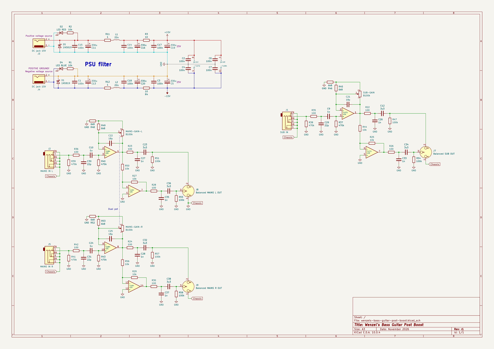

# Wenzel’s Bass Guitar Post Boost

I designed this unit to be used in conjunction with
[Wenzel’s Bass Guitar Sub X-Over](../wenzels-bass-guitar-sub-xover).

The X-Over goes at the beginning of the signal chain and this Post Boost at its
end, providing adjustable gain and low-impedance, electronically balanced
outputs for the power amplifiers.

## Features

- 3 unbalanced, high-impedance bass-guitar/pedalboard inputs
  (approximately 235 kΩ nominal midband input impedance):

  * 1 SUB input
  * 2 MAINS inputs (stereo L/R)

- 3 electronically balanced, AC-coupled XLR outputs:

  * 1 SUB output
  * 2 MAINS outputs (stereo L/R)

- 100 Ω series output resistance **per signal leg**.

  Approximately 200Ω differential source resistance at midband
  (frequency-dependent at low frequencies because of AC coupling).

- Separate gain controls:

  * SUB: one 100kΩ gain potentiometer
  * MAINS: one dual-gang 100kΩ gain potentiometer controlling L and R together

- Gain range:

  * Approximately **0 to +23.9 dB per output leg** (1.00× to 15.71×)

  * Approximately **+6.0 to +29.9 dB differential gain** from an unbalanced
    input to XLR pins 2–3 (2.00× to 31.41×), before external loading

- Potentiometer taper-shaping networks use 6.8 kΩ resistors.

  The exact gain-versus-knob position depends on the potentiometers and their
  tracking.

The outputs are **electronically balanced, not transformer-isolated**. They are
intended for balanced, high-impedance power-amplifier/line inputs,
preferably 10kΩ differential input impedance or higher.

**XLR pinout:** pin 2 = hot (+), pin 3 = cold (−), pin 1 = cable shield/chassis.

Because both audio legs are actively driven, **do not short pin 3 to ground or
pin 1** when connecting to unbalanced equipment. Use an appropriate
balanced-to-unbalanced interface or a wiring arrangement that leaves the cold
output unloaded; a single-leg connection has approximately 6 dB less level than
the balanced differential connection.

## Technical details

- Amplifiers: one TL072 dual op-amp for SUB and one TL084 quad op-amp for
  stereo MAINS; all six amplifier sections are used.

- Each channel consists of an adjustable non-inverting gain stage followed by a
  unity-magnitude inverting stage. The two outputs have approximately equal
  amplitudes and opposite polarity.

- Nominal input impedance: 470kΩ in parallel with 470kΩ, or approximately
  **235kΩ at midband**. The impedance increases toward DC because of the input
  coupling capacitor.

- Input AC-coupling high-pass cutoff: approximately **0.34 Hz** for each channel
  (1µF and 470kΩ, with a low-impedance signal source).

- Output AC coupling: **3.3µF per signal leg**, with a **100kΩ** resistor from
  each XLR audio pin to signal ground and a **100Ω** series resistor on each
  driven leg.

- Output high-pass cutoff into a **10kΩ balanced differential input**:
  approximately **9.9 Hz**. At 20 Hz the output coupling network is about
  **0.96 dB below its midband level**. This estimate assumes a symmetrical,
  10kΩ differential load.

- Output high-pass cutoff with a **10kΩ load from one signal leg to ground**:
  approximately **5.25 Hz**; this is a different load configuration from
  a 10kΩ differential balanced input.

- Approximate input RF suppression RC corner:
  **72 MHz** (100Ω / 22pF, assuming a low source impedance).

- Approximate output RF suppression RC corner:
  **1.6 MHz** (100Ω / 1nF).
  These RF estimates do not account for cables or amplifier bandwidth.

- High-frequency feedback compensation: **18pF** per adjustable gain stage.

- Power: nominal symmetrical **±15V**, derived from two isolated, regulated,
  floating 15V DC supplies.

- Maximum clean level is limited by the TL072/TL084 output swing, the connected
  load, and gain setting. The full boost range is not necessarily usable with
  hot pedalboard signals without clipping.

## Grounding and shield connections

The three input connectors carry unbalanced signals and **require a defined
signal-return connection to circuit GND**. The PCB and enclosure wiring must
make this explicit.

XLR pin 1 should connect to the metal chassis at the connector rather than carry
ordinary audio return current. The relationship between chassis and signal
ground must be defined deliberately to avoid hum and unintended floating ground
references.

## Power requirements

Two independent, isolated, regulated 15VDC power supplies with floating outputs:

- **Positive rail supply:**
  positive terminal to +15V, negative terminal to circuit GND.

- **Negative rail supply:**
  positive terminal to circuit GND, negative terminal to −15V.

Before these connections are made, the supplies must be isolated from each other
and their outputs must not already be connected to chassis, protective earth, or
another common supply reference.

Do not series-connect outputs that are already internally commoned unless the
supply is explicitly designed to provide symmetrical ±15V rails. Use
appropriately current-limited or fused supplies; the schematic’s shunt
reverse-polarity diodes can conduct heavily after a connection error.

## Latest revision schematic

## Releases (newest revisions are on the top)

- [r1 2026-11](release-2026-11-r1)
