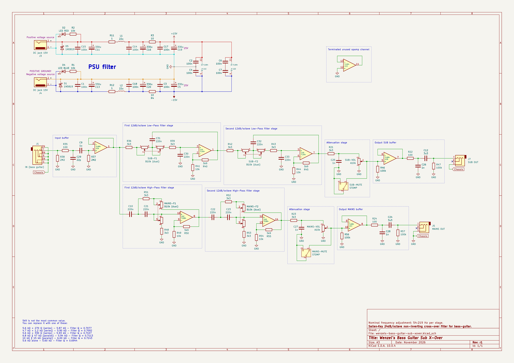

# Wenzel’s Bass Guitar Sub X-Over

Sallen–Key 24dB/octave non-inverting cross-over filter for bass-guitar.

Each output (“SUB” and “MAINS”) has its own independent frequency control.
Note that both “SUB” and “MAINS” have 2 dual-gang knobs, F1 and F2, ideally you
should set them both to the same position, same frequency. You can use 4-gang
potentiometers instead if you have them to have just 1 frequency control per
channel.

This unit is designed to go at the beginning of the signal chain and
[Wenzel’s Bass Guitar Post Boost](../wenzels-bass-guitar-post-boost) at its end,
providing adjustable gain and low-impedance, electronically balanced outputs for
the power amplifiers.

## Features

- 1 mono bass-guitar input with conventional ≈1M input impedance
- 1 “MAINS” output with ≈100Ω output impedance
- 1 “SUB” output with ≈100Ω output impedance
- Cross-over frequency knobs for “MAINS” and “SUB” channels
  (independent from each other)
- Mute stomp switch for each channel output

AC-coupled, unbalanced line-level outputs with 100Ω series output resistors;
intended for high-impedance amplifier inputs (≥10kΩ input impedance).

## Technical details

- Low-pass (“SUB” channel): two cascaded 12 dB/oct Butterworth sections,
  approximately 24 dB/octave overall.

- High-pass (“MAINS” channel): two cascaded 12 dB/oct Butterworth sections,
  approximately 24 dB/octve overall.

- Nominal frequency adjustment: 54–219 Hz per stage.

- Power: regulated ±15 V.

- Both branches are non-inverting, with approximately +8 dB passband gain
  through their two filter stages, before the attenuation and volume controls.

- Matching the two stage cutoffs within each branch gives the intended LR4
  alignment; adjusting them differently produces a stagger-tuned fourth-order
  response.

- Because “SUB” and “MAINS” cutoffs are independently adjustable,
  their combined response is not necessarily flat.

## Power requirements

Two independent, isolated, regulated 15V DC power supplies, with floating
outputs.

- Positive rail supply:
  +15 V terminal connects to +15 V;
  negative terminal connects to circuit GND.

- Negative rail supply:
  positive terminal connects to circuit GND;
  −15 V terminal connects to −15 V.

The two sources must be isolated from one another before connection.
Their outputs must not have pre-existing connections to protective earth,
chassis, or another shared supply reference.

Do not use two supply outputs that already share a common terminal unless the
supply is specifically designed to provide the required symmetrical ±15 V rails.

## Latest revision schematic

## Releases (newest revisions are on the top)

- [r1 2026-11](release-2026-11-r1)
