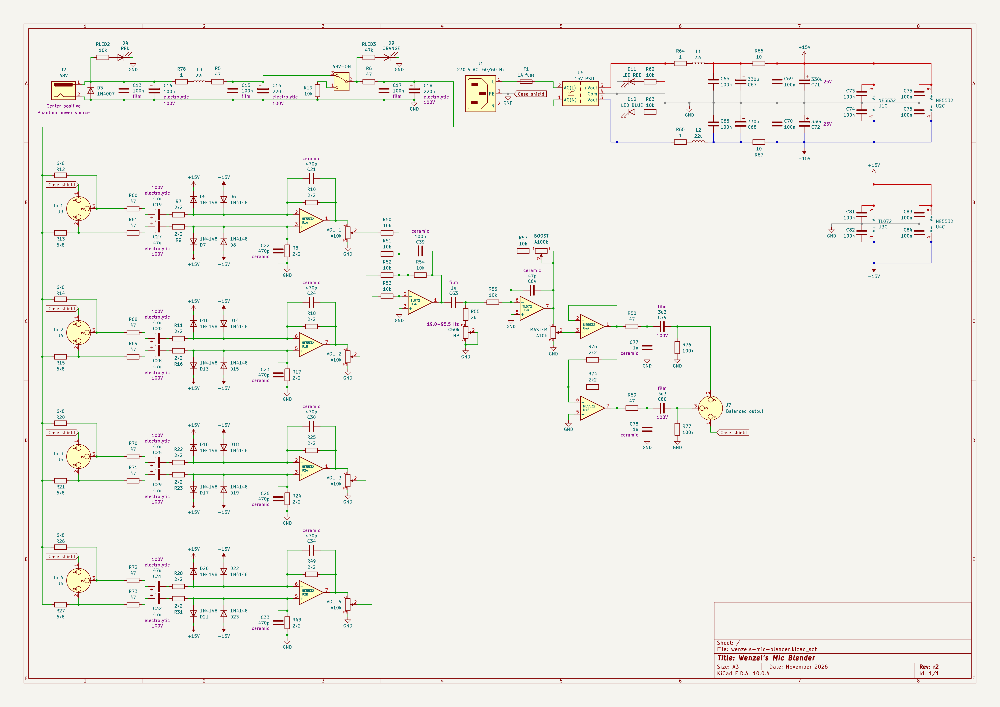

# Wenzel’s Mic Blender

A four-channel microphone blender with optional 48V phantom power, individual
channel attenuation, adjustable high-pass filtering, post-mix gain, and a
balanced line-level output.

I designed this device for blending multiple close-miked guitar cabinet speakers
into a single balanced output with optional phantom-powered FetHeads for the
microphones.

## Safety warning

This device contains mains-powered circuitry. Protective earth, enclosure
bonding, fusing, insulation, and mains wiring must be implemented according to
applicable electrical safety requirements.

**Mains voltages can be lethal!** If you don’t have the necessary knowledge
and experience, do not attempt to build this device yourself. Seek assistance
from a qualified professional instead.

## Signal path

1. 4 balanced microphone inputs with optional 48V phantom power
2. Balanced-to-single-ended conversion (unity gain)
3. Individual channel volume attenuation
4. Active summing stage
5. Always-on, adjustable first-order high-pass filter (19.0–95.5 Hz, 6 dB/octave)
6. Adjustable boost stage (0 to +20.83 dB)
7. Master volume attenuation
   (only attenuates the signal after the mixing and boost stages;
   it cannot prevent clipping in those stages)
8. Active balanced output stage
   (+6.02 dB differential voltage gain relative to a single output leg)

**Gain staging:** Summing multiple signals can produce high output levels and
cause clipping in the mixing or boost stages. Start with individual channel
levels and BOOST low, then gradually increase them while monitoring levels.
Use MASTER to adjust the final output level for the receiving equipment.

The balanced output is intended for line-level inputs on audio interfaces,
mixing consoles, or suitable signal splitters.

## Power requirements

- 48V DC: External supply for phantom power (optional, depending on connected
  microphones or inline preamps)
- 230V AC, 50/60 Hz: Mains input for the internal ±15 V DC op-amp power supply
  module (make sure the module you are going to use is compatible with your
  mains voltages and frequency)

## Latest revision schematic

## Releases (newest revisions are on the top)

- [r2 2026-11](release-2026-11-r2)
- [r1 2026-11](release-2026-11-r1)
