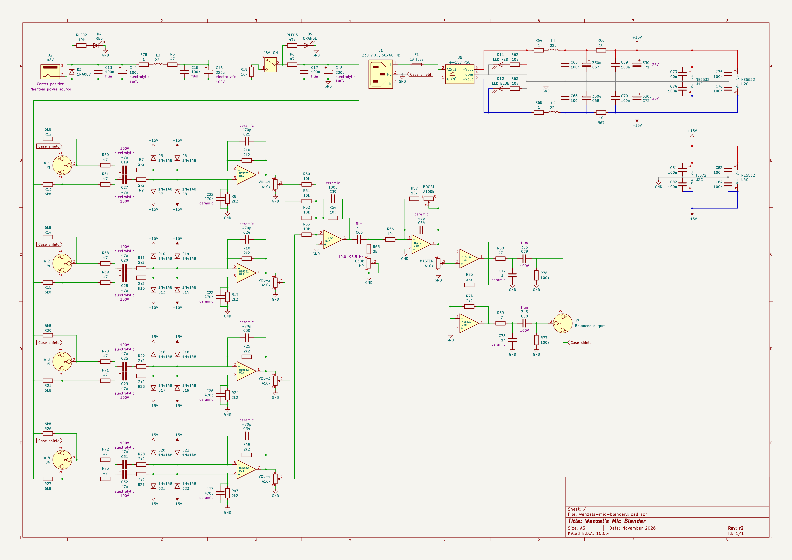

# Wenzel’s Mic Blender

Revision r2 (November 2026).

- [PDF schematic render](wenzels-mic-blender-r2.pdf)
- [PNG schematic render](wenzels-mic-blender-r2.png)

## Difference (changelog) from previous release (revision r1)

1. Added series inductor for 48V phantom power source filtering
   (for additional switch-mode power supply switching noise suppression)

2. Redrawn the schematic a little to get rid of cross-wiring
   (no connectivity or functional changes)
